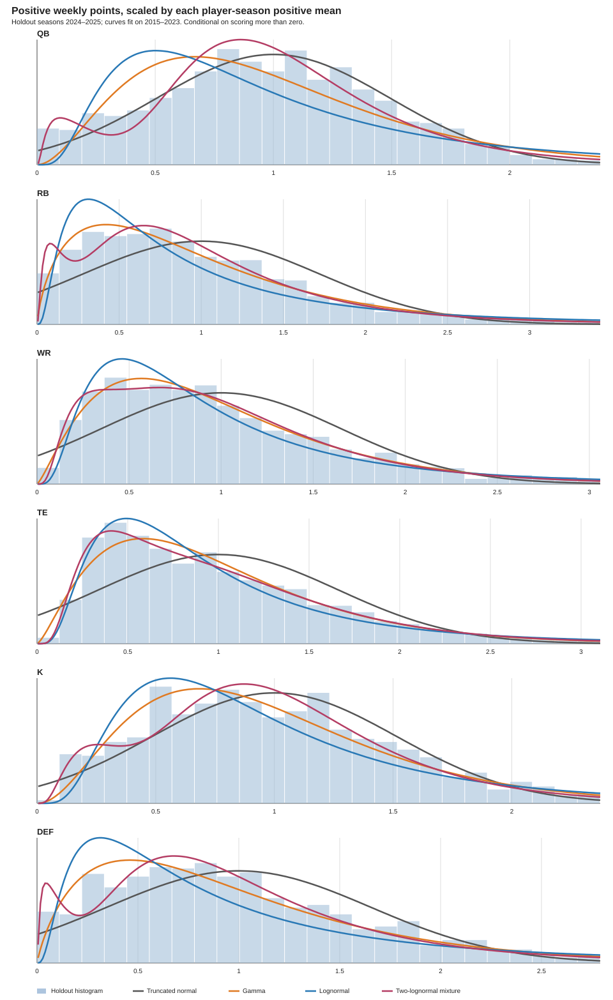

# Fantasy Football Dashboard Guide

> Living guide to the dashboard generated by `expected_wins.py` and the live matchup snapshots written by `live_logger.py`. I'll update the relevant section alongside feature changes before they're pushed. This is plain Markdown, so you can edit it directly at any time.

`expected_wins.py` is the dashboard source and generates `index.html`. `live_logger.py` writes the `live_week_*.json` history used by Matchup stats. Do not edit generated `index.html` as the durable source.

## Shared controls and navigation

The team acronym buttons beside the league title select that team across all team-selectable charts, including the current matchup containing that team, the power-rank history, and the multiverse views. This changes selections rather than removing other teams' data. Individual chart buttons can still be changed independently.

The URL's versioned `view` query parameter stores the main tab, each subtab, global and local team choices, ranking week, matchup/week, table sorts, pinned chart teams, hidden legend series/slices, opened model details, and a clicked roster distribution. Reloading or sharing the URL restores those choices; native Back/Forward gestures undo and redo intentional selections. Hover and automatic snapshot refreshes do not add history entries. `dashboard_state.js` is embedded into the generated page and is the durable source of this behavior.

All tables size columns to their content rather than fixed widths or stretched equal columns. Long headings wrap, numeric values remain visible, and PPG is shown beneath totals. On phones, standings use team acronyms with accessible full names, wide tables scroll internally with a scroll hint and sticky team/player identity column, and roster photos/names use a compact layout.

At widths up to 700px, navigation tabs and the global team strip scroll horizontally with 44px touch targets. Team-wide position, acquisition, actual/optimal, and starter/bench comparisons become horizontal bar charts. Mobile charts use wrapping HTML legend buttons that preserve URL-backed visibility; weekly charts retain readable heights and fewer date ticks. Cards, trade layouts, radars, and leaderboard badges adapt to the available width. Reduced-motion settings disable chart animation. `dashboard_mobile.css` and `dashboard_mobile.js` are embedded into the generated page. The [mobile readability plan and implementation status](MOBILE_READABILITY_PLAN.md) records remaining refinements and verification limits.

## Dashboard tabs

### League Stats

#### Standings

Shows each team's completed regular-season record, playoff position, points for/against, and point differential. The sortable Last 3 column, immediately after PCT, shows wins–losses–ties over up to three most recent completed games; it sorts by that recent win percentage. ESPN's weekly standings order supplies its tiebreak ordering. When divisions exist, the playoff preview promotes division winners before placing the remaining teams by that standings order.

For a team with wins $W$, losses $L$, ties $T$, and $G=W+L+T$ completed games:

$$\mathrm{PCT}=\frac{W+0.5T}{G},\qquad \mathrm{DIFF}=\mathrm{PF}-\mathrm{PA}$$

Games back is shown as:

$$\mathrm{GB}=\frac{(W_{leader}-W)+(L-L_{leader})}{2}$$

The playoff position is the projected seed, separate from ESPN rank. The divider appears only when sorted by position and marks the playoff cutoff. Clinching markers are appended to team names: `x` clinched a playoff berth, `y` clinched a division, `z` clinched a first-round bye, and `e` eliminated. The rules account for divisions and the number of playoff spots.

#### Power Rankings

Ranks teams after each completed week and for the current season. The score is a 0–100 weighted sum:

$$\mathrm{Power}=100\left(0.30R+0.30R_3+0.10P+0.10P_3+0.20Q\right)$$

Here $R$ is overall win percentage, $R_3$ is win percentage over the last three completed games, $P$ is min-max normalized season PPG, $P_3$ is min-max normalized PPG over those recent games, and $Q$ is min-max normalized quality rating. Ties count as half a win. The custom quality rating credits wins over above-average scoring opponents, penalizes losses to below-average scoring opponents, and weights each result by the opponent's record entering that week. It is an Elo-style quality measure, not a conventional Elo rating. The chart shows rank history; the table shows the selected week's rank and score, with a colored dot beside the team acronym instead of a separate color column.

#### Playoff Bracket

Projects playoff seeds from the current standings and uses in-progress regular-season scores when available. ESPN settings supply the playoff team count, divisions, seeding rule, matchup periods, round dates, and tier type. The display draws the winner bracket, including byes, and a consolation bracket or ladder where ESPN's format indicates one. This supports common variations such as different playoff sizes and divisional seeding; an unusual custom tier format may require a format-specific adjustment.

### Matchup stats

#### Upcoming Matchup

The matchup buttons appear above the week buttons. These controls update three views together: a single mirrored starting-lineup table, overlapping distributions of projected team totals, and the live win-probability chart. The table pairs players by starting slot, orders slot groups as in ESPN (QB, RB, WR, TE, FLEX/other offensive flex, K, D/ST, with configured extra slots), places opposing projections beside each other across a central divider, includes small player photos, shades home/away blue/orange, and totals each side at the bottom. Columns follow their content; mobile uses initials plus surnames with full names available in accessible labels/titles. Starter rows with no usable ESPN projection remain visible and count toward the coverage fraction; their missing values are not silently counted as zero. The lineup and projected-total views currently use the current matchup week. Historical week buttons show a note because per-player lineup projections are not archived in the live snapshots yet.

For a team with starter projections $p_i$, the expected total is $μ_t=\sum_i p_i$. A sum of lognormal variables is generally neither normal nor a single lognormal. The chart therefore shows histogram densities from 10,000 sums of individually simulated starter outcomes rather than imposing a normal team curve. Each player's positive component is lognormal, with an empirical component for observed zero/negative score-to-projection ratios. The mixture is centered on ESPN's projection, uses only completed prior weeks, and falls back to a positive prior without history. Dashed lines mark ESPN projected totals; missing projections make those totals partial. See [the matchup scoring model](MATCHUP_SCORING_MODEL.md) for the formulas, statistical sources, and limitations.

The displayed points range spans the union of both teams' central 95% intervals, from the smaller 2.5th-percentile score to the larger 97.5th-percentile score. Quantiles use the original simulation draws, not a percentage of the peak density height. This crops the long visual tails without changing simulations, probability calculations, or projections.

The live win-probability chart uses the same selected matchup. It uses saved score/projection snapshots, gives equal horizontal space to each observation, shades game and high-frequency sampling windows, and retains the recorded observation times on the x-axis. If no snapshots exist yet, the chart is empty while the upcoming lineup and projection comparison remain available.

For each unfinished starter, remaining mean points are $r_i=\max(0,p_i-s_i)$, where $p_i$ is the ESPN projection and $s_i$ is current points. If the player has exceeded projection during an active game, the fallback mean is $\max(p_i,s_i,0)(1-g_i)$, preserving remaining upside. The positive lognormal shape uses past positive score/projection ratios when available; otherwise its prior SD is $\max(3\sqrt{1-g_i},1.7\sqrt{\max(r_i,\max(p_i,s_i,0)(1-g_i))})$. Here $g_i$ is game progress, estimated from kickoff over a three-hour window when ESPN reports only 0 or 100. Observed nonpositive ratios are scaled by unplayed fraction and are the only source of negative simulated remaining points. Bench, IR, and finished players have no future draws.

The logger samples 5,000 individual-player remaining-score totals, adds current team scores, and reports home wins with ties counted as half. The independent-player assumption does not model teammate/opponent correlations; these estimates still need calibration. During scheduled or active NFL game windows the logger targets one observation per ten-minute bucket. The five-minute workflow is offset from the top of the hour, but GitHub Actions can delay or drop scheduled jobs, so exact ten-minute delivery is not guaranteed. Existing archived probabilities remain unchanged.

### Team Stats

#### Positional Breakdown

Aggregates starter fantasy points by player position (QB, RB, WR, TE, K, D/ST). A FLEX or other multi-position slot is attributed to the player's position. It includes a six-axis radar view, totals across teams, a selected team's weekly stack, and a sortable totals table. Weekly position sums are:

$$P_{t,w,k}=\sum_{i\in\text{team }t,\,\text{week }w,\,\text{position }k}\mathrm{points}_{i,w}$$

#### Acquisitional Breakdown

Groups starter points by how the player joined that fantasy roster: drafted, traded, or waivers/free agency. It displays league totals, weekly selected-team totals, and a sortable table. Weekly source points are the sum of the starter points assigned to that acquisition source. ESPN draft and transaction history are used where available; unclassified acquisitions use a waiver/free-agent fallback.

#### Starters vs. Bench

Compares actual lineup points with bench points and the best lineup that could have been set from the players available that week. The optimal-lineup calculation assigns each non-IR player to at most one ESPN starter slot, respects slot eligibility, and maximizes total points while retaining the actual starter-slot mix.

$$\mathrm{LeftOnBench}_w=\max(0,\mathrm{Optimal}_w-\mathrm{Actual}_w)$$

The summary table reports season totals, per-game averages, and realization of the optimal lineup. The charts compare actual versus optimal lineup points and starter versus bench totals across teams. The candle/distribution chart has been removed; points left on the bench still inform the optimal-lineup calculations and leaderboard.

#### Win/Loss Differential

Shows weekly points scored minus points allowed, centered at zero and colored by matchup result. The summary chart reports the average absolute differential in wins above zero and the negative average absolute differential in losses below zero.

$$d_w=\mathrm{PF}_w-\mathrm{PA}_w$$

#### Rosters

Shows each selected team's current roster, including players currently on that roster whose earlier scoring weeks were spent on other fantasy teams. Bye weeks are excluded. Season PPG is the mean of a player's completed weekly scores; $\overline{\Delta}$ vs. Projections (PPG) is the mean of actual points minus the initial ESPN projection across weeks with a usable projection. `SD vs. Projections` is the modelled standard deviation of weekly actual-minus-ESPN-projection points, using every available completed week with both an actual and positive ESPN projection. A player-specific lognormal fit is used with at least two positive score/projection ratios; shorter histories use a pooled same-position prior, then a league-wide prior, when at least one usable player-week exists. The value remains blank when even those data are unavailable.

Hovering, focusing, or clicking an SD vs. Projections value opens the weekly scoring distribution. For each eligible week, the model forms the ratio $R_i=S_i/P_i$, where $S_i$ is actual fantasy score and $P_i$ is that week's ESPN projection. Positive ratios are fitted as $\log(R)\sim N(\mu,\sigma^2)$; observed zero and negative ratios are retained as an empirical component, because a lognormal curve cannot represent them. The mixture is $R\sim q\,\mathrm{Lognormal}(\mu,\sigma^2)+(1-q)F_{\leq0}$, where $q$ is the observed share of positive ratios and $F_{\leq0}$ is the empirical distribution of nonpositive ratios. The hover graph scales the ratio model by the selected ESPN projection, shows the positive lognormal density, plots all weekly actual scores as yellow dots, and marks the model mean and ESPN projection with dashed lines. Only weekly scores, ESPN projection, and model mean appear in the legend; the distribution is omitted. Its horizontal range is 0–50, expanding only to include observed negative or above-50 weekly scores. The displayed SD vs. Projections is calculated from this projection-scaled mixture across the player's historical ESPN projections, not from the raw sample SD of fantasy points. Specifically, for empirical projections $P$ and a ratio $R$ assumed independent of $P$, $\mathrm{SD}(S-P)=\sqrt{\mathbb{E}[P^2]\mathbb{E}[(R-1)^2]-\{\mathbb{E}[P]\mathbb{E}[R-1]\}^2}$. When individual history is short, the lognormal shape comes from a same-position pool, then a league-wide pool, while the player's own historical projections scale the error SD. D/ST players use NFL team logos when a team logo can be identified.

On phones, explicitly tapping an SD value opens a pinned bottom sheet with a visible Close button, safe-area padding, internal scrolling, a backdrop, keyboard focus containment, and Escape support. Closing returns focus to that player's SD control. Hover/focus previews remain nonmodal on desktop.

### Luck Stats

#### Luck

Expected wins compare a team's score with every other team's score in the same week, not only its scheduled opponent. For team score $s_{t,w}$ among $N$ league teams:

$$xW_{t,w}=\frac{\#(s_{j,w}<s_{t,w})+0.5\,\#(j\ne t,\;s_{j,w}=s_{t,w})}{N-1}$$

A scheduled win counts 1, a tie 0.5, and a loss 0. Expected wins sum weekly $xW$; schedule luck is:

$$\mathrm{Luck}_t=\mathrm{ActualWins}_t-\sum_w xW_{t,w}$$

The subtab includes cumulative actual and expected wins, a league luck comparison, and a heatmap of weekly expected win shares.

#### Win/Loss Quality

Measures how strong the opponent's score was relative to that week's league scoring distribution. For opponent score $o$, weekly league mean $\mu_w$, and standard deviation $\sigma_w$:

$$z_w=\frac{o-\mu_w}{\sigma_w}$$

An above-average opponent win earns $\max(z_w,0)q_w$; a loss to a below-average opponent contributes $-\max(-z_w,0)q_w$. Ties contribute zero. The weight is $q_w=0.75+0.5r_w$, where $r_w$ is the opponent's win percentage entering the matchup (0.5 when no prior record exists). The table reports average quality in wins, average quality in losses, and their net, plus opponent PPG in each outcome type.

#### Fantasy Multiverse

Keeps each team's actual weekly score fixed and samples 20,000 valid round-robin schedules. Each simulated schedule has every opponent once, then repeats the same early-round opponents to fill the regular season. Matchups are re-drawn for each simulation. It applies the league's division and configured tiebreak rules, then records wins, standings, and first-place outcomes; completed postseason scores can also be used to estimate playoff advancement and title frequencies.

The charts show a selected team's wins distribution, distributions for all teams, the actual schedule result and percentile, and each team's share of first-place finishes or simulated titles. The selected team's pie slice is offset with a brighter border while other slices are dimmed. These are schedule-variance simulations, not projections of future player scores.

### Trades

Shows completed accepted trades by team. For each trade, player points are counted from the week after the trade through the last completed scoring week. The team's trade yield is:

$$\mathrm{NetPoints}=\mathrm{IncomingPoints}-\mathrm{OutgoingPoints},\qquad \mathrm{PointsPerWeek}=\frac{\mathrm{NetPoints}}{\mathrm{CompletedWeeksAfterTrade}}$$

The cumulative chart has separate raw received-minus-sent and starter-only received-minus-sent lines. Starter-only points count a player only in weeks actually started by the fantasy team that received that player in the trade; bench weeks and later owners do not count. Outgoing starter points are measured for their receiving team and subtracted. Missing historical ownership never invents a start. Per-trade charts show one line per player, with larger points for recipient-team starts, and sent/received photos both have blue outlines. The team rating continues to use raw net points. Rating cutoffs are heuristic: at least +5 points/week is “GM of the Year,” at least +1 “Won the Trade,” above −1 “Even Trade,” above −5 “Lost the Trade,” and −5 or below “Fleeced.” ESPN may restrict trade history; complete records can require `ESPN_S2` and `SWID` repository secrets.

### Leaderboard

Shows the top and bottom team for four current-season categories: highest total points scored, schedule luck, points left on the bench per game, and summed trade points per week. Higher is better for scoring, luck, and trade value; lower is better for points left on the bench. These are descriptive season awards, not predictive ratings.

## Planned Features

## Research

### Market-informed player projection research plan

The goal is to test whether pregame NFL market information improves fantasy-point projections under this league's ESPN scoring rules. It is a model-quality study, not a betting tool. ESPN's data interface and community wrappers expose week-specific scoring periods and weekly projected/actual player scores, so historical season/week values are a promising starting point. Explicit season and scoring-period queries can access prior weeks, but ESPN's historical-league endpoint now requires an `espn_s2` cookie, and private-league access may require the existing ESPN credentials. Retrieved projections do not guarantee the exact value published before kickoff: ESPN projections can be revised, historical endpoints can change, and the API does not provide a reliable point-in-time timestamp for each old value. The current lineup snapshots should therefore be archived with their capture timestamp and kickoff to create an auditable, true pregame projection history. See the [ESPN player-field reference](https://github.com/cwendt94/espn-api/wiki/Player-Class), [fflr weekly scoring-period documentation](https://k5cents.github.io/fflr/), and its [API access notes](https://k5cents.github.io/fflr/reference/ffl_api.html).

Historical spread and game-total data are available in nflverse's schedule/game data. Its documented `spread_line` is positive when the home team is favored, and `total_line` is the game total; nflfastR identifies these as closing lines sourced from Pro-Football-Reference. The documented Games data begins in 2006, which is enough for broad backtesting but is a single closing value, without a retained capture time or a line-movement history. It should be treated as a useful historical baseline, not a verified pre-kickoff snapshot at a chosen cutoff. See the [nflverse Games data definitions](https://github.com/nflverse/nfldata/blob/master/DATASETS.md?plain=1#L819-L881) and the [nflfastR release notes](https://github.com/nflverse/nflfastR/blob/master/NEWS.md).

1. **Audit the historical ESPN fields.** For several completed seasons, request one `seasonId` and `scoringPeriodId` at a time, then compare ESPN weekly projected and actual points against known completed weeks and this league's scoring settings. Record which player types, weeks, and past seasons return usable projected values. Label these as historical weekly projections unless their pre-kickoff timing can be independently established.
2. **Start an immutable projection archive.** Extend the existing scheduled workflow to save every player projection snapshot with season, week, ESPN player ID, NFL team, position, league scoring configuration, `captured_at`, and scheduled kickoff. Preserve every observation rather than overwriting it. For each model row, choose the latest capture strictly before that player's NFL kickoff, and exclude any post-kickoff value.
3. **Join market context.** Map player team and opponent to NFL game ID, season, and week. Use historical closing spread/total for initial broad analysis, clearly marked as closing-line features. For a strict as-of backtest, obtain and archive time-stamped line snapshots (including source/provider and capture time) so market and ESPN inputs use the same pregame cutoff. Convert game lines to implied team points with the nflverse sign convention: $\text{home implied points}=(\text{total}+\text{spread})/2$ and $\text{away implied points}=(\text{total}-\text{spread})/2$.
4. **Build and compare models.** Establish an ESPN-only baseline, then add implied team points and spread as features to a player-level projection model. Add position, player's recent role/opportunity, injury/availability, and scoring settings only when those fields were known at the same cutoff. Fit with season-forward training and temporal holdouts; tune by position and score component rather than randomly splitting player-weeks.
5. **Evaluate without leakage.** Reconstruct target fantasy points from NFL statistics and the exact ESPN league scoring rules. Compare MAE and RMSE against ESPN-only projections, and assess bias and interval calibration by position, projection range, and season. Verify all features were captured before kickoff and avoid postgame stats, closing lines mislabeled as early lines, or end-of-week ESPN revisions. Keep the simpler ESPN baseline if market features fail to improve held-out accuracy consistently.

The nflverse schedule is accessible and well suited to an initial exploratory analysis, but its closing spread/total alone cannot answer whether a line was available at a specific pregame moment. Capturing ESPN projection and market timestamps going forward is the key step for a trustworthy point-in-time training set.

### Existing weekly scoring study

This section summarizes the [full model study](../analysis/player_score_models/report.md). The reproducible scoring reconstruction uses public [nflverse player, team, snap-count, and play-by-play data](https://github.com/nflverse/nflverse-data) and this league's current [ESPN scoring settings](https://support.espn.com/hc/en-us/articles/360003914032-Scoring-Formats). It rescored 81,343 active regular-season player-games from 2015–2025; 2015–2023 trained the curves and 2024–2025 were held out. The 2026 league settings were applied retroactively.

The reconstruction matched 998 current ESPN rostered player-games; 98.7% were within 0.05 points, with 0.015 points mean absolute error. QB, RB, and TE matched exactly in the comparison. Remaining differences were concentrated in a small number of WR, kicker, and D/ST games.

### Why one normal curve is insufficient

Weekly scoring has a large exact-zero outcome for some positions, a separate negative tail from turnovers and defensive scoring, and a right-skewed positive outcome. On the 2024–2025 holdout set, normal fits to individual player-seasons substantially overestimated below-zero probabilities for RB, WR, and TE, while the observed exact-zero rates were high.

| Position | Exact zero | Negative | Under 1 point | Normal fit below 0 |
|---|---:|---:|---:|---:|
| QB | 3.6% | 7.4% | 16.4% | 4.4% |
| RB | 14.8% | 1.4% | 24.4% | 11.4% |
| WR | 26.8% | 0.7% | 29.1% | 13.0% |
| TE | 40.3% | 0.2% | 41.1% | 15.7% |
| K | 2.3% | 0.9% | 3.4% | 4.0% |
| D/ST | 0.2% | 12.8% | 16.7% | 13.6% |

### Proposed player-level model

Use a three-part distribution with position- and player-informed negative scores, a point mass at zero, and a positive-score curve. Let $p_-$, $p_0$, and $p_+$ be the probabilities of negative, zero, and positive scores, with $p_-+p_0+p_+=1$. If $m_+$ is a player's typical score conditional on scoring positively and $Y$ is the normalized positive shape, then:

$$S\sim\begin{cases}\text{negative-score distribution},&p_-\\0,&p_0\\m_+Y,&p_+\end{cases}$$

The density transformation for positive scores is $f_S(s)=m_+^{-1}f_Y(s/m_+)$, for $s>0$. Gamma and lognormal-mixture curves are both positive-only and therefore cannot assign impossible negative values to the positive component. Estimate player-specific zero and negative rates from their own history and shrink them toward position baselines when the player sample is short.

### Held-out positive-score curve comparison

Scores above zero were divided by each player's positive-game mean before fitting. The table gives the candidate with the highest 2024–2025 held-out mean log score; differences are small for several positions, so the top model should be treated as a useful shape choice rather than a universal truth.

| Position | Best positive component | Mean log score | Observed / fitted share below 25% of positive mean |
|---|---|---:|---:|
| QB | Two-lognormal mixture | −0.741 | 7.7% / 6.9% |
| RB | Two-lognormal mixture; Gamma is essentially tied | −0.918 | 11.0% / 11.8% |
| WR | Gamma | −0.842 | 7.2% / 7.0% |
| TE | Two-lognormal mixture; Gamma is essentially tied | −0.815 | 4.5% / 5.8% |
| K | Two-lognormal mixture | −0.723 | 5.2% / 5.9% |
| D/ST | Two-lognormal mixture; Gamma is close | −0.890 | 8.9% / 10.3% |

The fitted positional positive curves and holdout histogram are shown here:

The player-history hover graph in Rosters now fits a lognormal curve to positive weekly score/ESPN-projection ratios, while retaining observed zero and negative ratios as a discrete empirical component. This roster-specific fit is separate from the position-level zero/negative/positive candidate models in the study above. Detailed candidate fits, parameters, scoring validation, and limitations are in [the study report](../analysis/player_score_models/report.md), [the parameter file](../analysis/player_score_models/fit_parameters.json), and [the CSV comparison](../analysis/player_score_models/model_comparison.csv).
