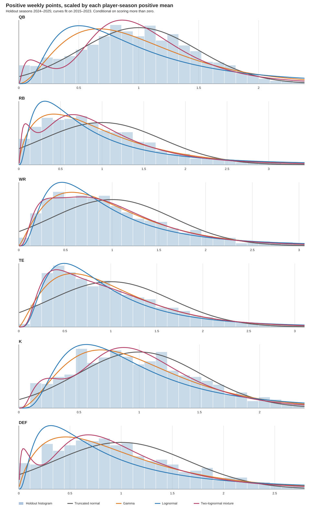

# Fantasy Football Dashboard Guide

> Living guide to the dashboard generated by `expected_wins.py` and the live matchup snapshots written by `live_logger.py`. I'll update the relevant section alongside feature changes before they're pushed. This is plain Markdown, so you can edit it directly at any time.

`expected_wins.py` is the dashboard source and generates `index.html`. `live_logger.py` writes the `live_week_*.json` history used by Matchup stats. Do not edit generated `index.html` as the durable source.

## Dashboard tabs

### League Stats

#### Standings

Shows each team's completed regular-season record, playoff position, points for/against, and point differential. ESPN's weekly standings order supplies its tiebreak ordering. When divisions exist, the playoff preview promotes division winners before placing the remaining teams by that standings order.

For a team with wins $W$, losses $L$, ties $T$, and $G=W+L+T$ completed games:

$$\mathrm{PCT}=\frac{W+0.5T}{G},\qquad \mathrm{DIFF}=\mathrm{PF}-\mathrm{PA}$$

Games back is shown as:

$$\mathrm{GB}=\frac{(W_{leader}-W)+(L-L_{leader})}{2}$$

The playoff position is the projected seed, separate from ESPN rank. The divider appears only when sorted by position and marks the playoff cutoff. Clinching markers are appended to team names: `x` clinched a playoff berth, `y` clinched a division, `z` clinched a first-round bye, and `e` eliminated. The rules account for divisions and the number of playoff spots.

#### Power Rankings

Ranks teams after each completed week and for the current season. The score is a 0–100 weighted sum:

$$\mathrm{Power}=100\left(0.20R+0.10P+0.30R_3+0.20P_3+0.20Q\right)$$

Here $R$ is overall win percentage, $R_3$ is win percentage over the last three completed games, $P$ is min-max normalized season points, $P_3$ is min-max normalized points over those recent games, and $Q$ is min-max normalized quality rating. The custom quality rating credits wins over above-average scoring opponents, penalizes losses to below-average scoring opponents, and weights each result by the opponent's record entering that week. It is an Elo-style quality measure, not a conventional Elo rating. The chart shows rank history; the table shows the selected week's rank, score, and team color.

#### Playoff Bracket

Projects playoff seeds from the current standings and uses in-progress regular-season scores when available. ESPN settings supply the playoff team count, divisions, seeding rule, matchup periods, round dates, and tier type. The display draws the winner bracket, including byes, and a consolation bracket or ladder where ESPN's format indicates one. This supports common variations such as different playoff sizes and divisional seeding; an unusual custom tier format may require a format-specific adjustment.

### Matchup stats

Shows the selected matchup's estimated win probability through the scoring period. The x-axis gives equal space to each recorded observation, so the chart emphasizes score updates rather than elapsed clock time. Game windows and higher-frequency sampling windows are shaded; time labels identify when observations were recorded.

For each active starter, remaining projected points are estimated as $r_i=\max(0,p_i-s_i)$, where $p_i$ is the ESPN projection and $s_i$ is current points. A player's remaining-score standard deviation is approximated as:

$$\sigma_i=\max\left(3,\;1.7\sqrt{\max\left(r_i,\max(p_i,s_i,0)(1-g_i)\right)}\right)$$

where $g_i$ is the reported fraction of the player's game completed. Bench and injured-reserve players are excluded. Team means add the remaining projections; team variances add the player variances. The dashboard samples 5,000 normally distributed final margins and reports the percentage of samples won by the home team. This is a practical approximation based on ESPN projections, not a calibrated player-outcome model.

### Team Stats

#### Positional Breakdown

Aggregates starter fantasy points by player position (QB, RB, WR, TE, K, D/ST). A FLEX or other multi-position slot is attributed to the player's position. It includes a six-axis radar view, totals across teams, a selected team's weekly stack, and a sortable totals table. Weekly position sums are:

$$P_{t,w,k}=\sum_{i\in\text{team }t,\,\text{week }w,\,\text{position }k}\mathrm{points}_{i,w}$$

#### Acquisitional Breakdown

Groups starter points by how the player joined that fantasy roster: drafted, traded, or waivers/free agency. It displays league totals, weekly selected-team totals, and a sortable table. Weekly source points are the sum of the starter points assigned to that acquisition source. ESPN draft and transaction history are used where available; unclassified acquisitions use a waiver/free-agent fallback.

#### Starters vs. Bench

Compares actual lineup points with bench points and the best lineup that could have been set from the players available that week. The optimal-lineup calculation assigns each non-IR player to at most one ESPN starter slot, respects slot eligibility, and maximizes total points while retaining the actual starter-slot mix.

$$\mathrm{LeftOnBench}_w=\max(0,\mathrm{Optimal}_w-\mathrm{Actual}_w)$$

The summary table reports season totals and per-game averages. The weekly chart compares starter and bench totals; the points-left chart shows each week's value as a dot, the team mean ± one sample standard deviation as a candle, and the weekly minimum/maximum as whiskers. Color moves from green for lower average points left to red for higher average points left.

#### Win/Loss Differential

Shows weekly points scored minus points allowed, centered at zero and colored by matchup result. The summary chart reports the average absolute differential in wins above zero and the negative average absolute differential in losses below zero.

$$d_w=\mathrm{PF}_w-\mathrm{PA}_w$$

#### Rosters

Shows each selected team's current roster, including players currently on that roster whose earlier scoring weeks were spent on other fantasy teams. Bye weeks are excluded. Season PPG is the mean of a player's completed weekly scores; `Points vs. Initial Projections (PPG)` is the mean of actual points minus the initial ESPN projection across weeks with a usable projection. The `Projection SD` column is the sample standard deviation of those actual-minus-projection residuals and requires at least two projection/scoring pairs.

Hovering, focusing, or clicking a Projection SD value opens the weekly scoring distribution. It shows the actual weekly scores as dots, their sample mean and scoring SD, a fitted normal density, the current ESPN projection, and markers for score and projection SDs. The normal curve describes the observed score history; the separate Projection SD measures projection error. D/ST players use NFL team logos when a team logo can be identified.

### Luck Stats

#### Luck

Expected wins compare a team's score with every other team's score in the same week, not only its scheduled opponent. For team score $s_{t,w}$ among $N$ league teams:

$$xW_{t,w}=\frac{\#(s_{j,w}<s_{t,w})+0.5\,\#(j\ne t,\;s_{j,w}=s_{t,w})}{N-1}$$

A scheduled win counts 1, a tie 0.5, and a loss 0. Expected wins sum weekly $xW$; schedule luck is:

$$\mathrm{Luck}_t=\mathrm{ActualWins}_t-\sum_w xW_{t,w}$$

The subtab includes cumulative actual and expected wins, a league luck comparison, and a heatmap of weekly expected win shares.

#### Win/Loss Quality

Measures how strong the opponent's score was relative to that week's league scoring distribution. For opponent score $o$, weekly league mean $\mu_w$, and standard deviation $\sigma_w$:

$$z_w=\frac{o-\mu_w}{\sigma_w}$$

An above-average opponent win earns $\max(z_w,0)q_w$; a loss to a below-average opponent contributes $-\max(-z_w,0)q_w$. Ties contribute zero. The weight is $q_w=0.75+0.5r_w$, where $r_w$ is the opponent's win percentage entering the matchup (0.5 when no prior record exists). The table reports average quality in wins, average quality in losses, and their net, plus opponent PPG in each outcome type.

#### Fantasy Multiverse

Keeps each team's actual weekly score fixed and samples 20,000 valid round-robin schedules. Each simulated schedule has every opponent once, then repeats the same early-round opponents to fill the regular season. Matchups are re-drawn for each simulation. It applies the league's division and configured tiebreak rules, then records wins, standings, and first-place outcomes; completed postseason scores can also be used to estimate playoff advancement and title frequencies.

The charts show a selected team's wins distribution, distributions for all teams, the actual schedule result and percentile, and each team's share of first-place finishes or simulated titles. These are schedule-variance simulations, not projections of future player scores.

### Trades

Shows completed accepted trades by team. For each trade, player points are counted from the week after the trade through the last completed scoring week. The team's trade yield is:

$$\mathrm{NetPoints}=\mathrm{IncomingPoints}-\mathrm{OutgoingPoints},\qquad \mathrm{PointsPerWeek}=\frac{\mathrm{NetPoints}}{\mathrm{CompletedWeeksAfterTrade}}$$

The view shows a cumulative received-minus-sent chart, per-trade incoming/outgoing players and weekly points, and a team rating. Rating cutoffs are heuristic: at least +5 points/week is “GM of the Year,” at least +1 “Won the Trade,” above −1 “Even Trade,” above −5 “Lost the Trade,” and −5 or below “Fleeced.” ESPN may restrict trade history; complete records can require `ESPN_S2` and `SWID` repository secrets.

### Leaderboard

Shows the top and bottom team for four current-season categories: highest total points scored, schedule luck, points left on the bench per game, and summed trade points per week. Higher is better for scoring, luck, and trade value; lower is better for points left on the bench. These are descriptive season awards, not predictive ratings.

## Planned Features

## Research: weekly player scoring distributions

This section summarizes the [full model study](../analysis/player_score_models/report.md). The reproducible scoring reconstruction uses public [nflverse player, team, snap-count, and play-by-play data](https://github.com/nflverse/nflverse-data) and this league's current [ESPN scoring settings](https://support.espn.com/hc/en-us/articles/360003914032-Scoring-Formats). It rescored 81,343 active regular-season player-games from 2015–2025; 2015–2023 trained the curves and 2024–2025 were held out. The 2026 league settings were applied retroactively.

The reconstruction matched 998 current ESPN rostered player-games; 98.7% were within 0.05 points, with 0.015 points mean absolute error. QB, RB, and TE matched exactly in the comparison. Remaining differences were concentrated in a small number of WR, kicker, and D/ST games.

### Why one normal curve is insufficient

Weekly scoring has a large exact-zero outcome for some positions, a separate negative tail from turnovers and defensive scoring, and a right-skewed positive outcome. On the 2024–2025 holdout set, normal fits to individual player-seasons substantially overestimated below-zero probabilities for RB, WR, and TE, while the observed exact-zero rates were high.

| Position | Exact zero | Negative | Under 1 point | Normal fit below 0 |
|---|---:|---:|---:|---:|
| QB | 3.6% | 7.4% | 16.4% | 4.4% |
| RB | 14.8% | 1.4% | 24.4% | 11.4% |
| WR | 26.8% | 0.7% | 29.1% | 13.0% |
| TE | 40.3% | 0.2% | 41.1% | 15.7% |
| K | 2.3% | 0.9% | 3.4% | 4.0% |
| D/ST | 0.2% | 12.8% | 16.7% | 13.6% |

### Proposed player-level model

Use a three-part distribution with position- and player-informed negative scores, a point mass at zero, and a positive-score curve. Let $p_-$, $p_0$, and $p_+$ be the probabilities of negative, zero, and positive scores, with $p_-+p_0+p_+=1$. If $m_+$ is a player's typical score conditional on scoring positively and $Y$ is the normalized positive shape, then:

$$S\sim\begin{cases}\text{negative-score distribution},&p_-\\0,&p_0\\m_+Y,&p_+\end{cases}$$

The density transformation for positive scores is $f_S(s)=m_+^{-1}f_Y(s/m_+)$, for $s>0$. Gamma and lognormal-mixture curves are both positive-only and therefore cannot assign impossible negative values to the positive component. Estimate player-specific zero and negative rates from their own history and shrink them toward position baselines when the player sample is short.

### Held-out positive-score curve comparison

Scores above zero were divided by each player's positive-game mean before fitting. The table gives the candidate with the highest 2024–2025 held-out mean log score; differences are small for several positions, so the top model should be treated as a useful shape choice rather than a universal truth.

| Position | Best positive component | Mean log score | Observed / fitted share below 25% of positive mean |
|---|---|---:|---:|
| QB | Two-lognormal mixture | −0.741 | 7.7% / 6.9% |
| RB | Two-lognormal mixture; Gamma is essentially tied | −0.918 | 11.0% / 11.8% |
| WR | Gamma | −0.842 | 7.2% / 7.0% |
| TE | Two-lognormal mixture; Gamma is essentially tied | −0.815 | 4.5% / 5.8% |
| K | Two-lognormal mixture | −0.723 | 5.2% / 5.9% |
| D/ST | Two-lognormal mixture; Gamma is close | −0.890 | 8.9% / 10.3% |

The fitted positional positive curves and holdout histogram are shown here:

The player-history hover graph in Rosters currently overlays a fitted normal curve for context; it has not yet switched to this proposed mixture model. Detailed candidate fits, parameters, scoring validation, and limitations are in [the study report](../analysis/player_score_models/report.md), [the parameter file](../analysis/player_score_models/fit_parameters.json), and [the CSV comparison](../analysis/player_score_models/model_comparison.csv).
